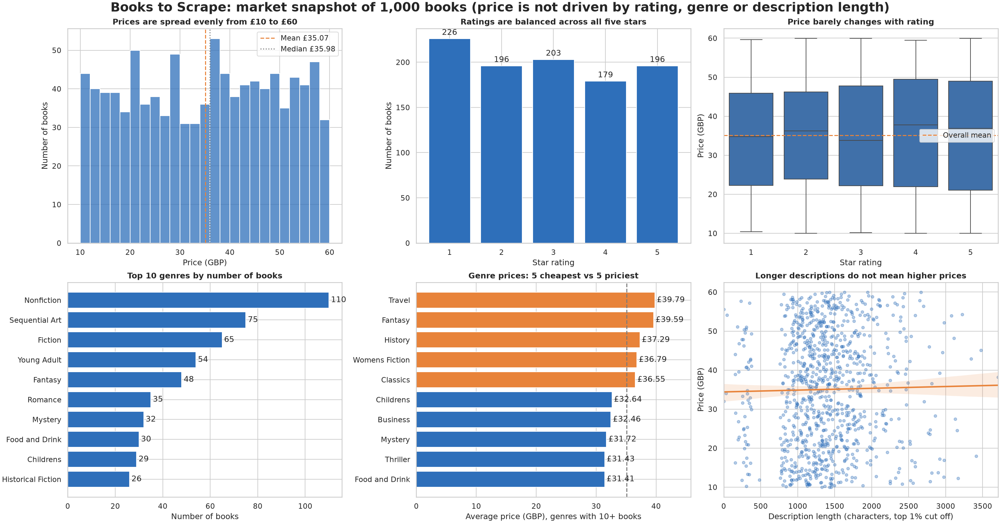

# CodeAlpha_BookMarketAnalysis

## Task 2: Exploratory Data Analysis

**Dataset:** 1,000 books, 50 categories, scraped from books.toscrape.com. Full output is in `eda_report.txt`, charts are in `images/`, and the cleaned data is in `data/books_clean.csv`.

### Key findings
- **Prices:** range from £10.00 to £59.99, with a mean of £35.07 and a median of £35.98. The distribution is nearly symmetric (skewness -0.04) and spread across the whole range rather than bell-shaped.
- **Ratings:** fairly even. Each star rating holds 18% to 23% of books. 1-star is the largest group (226 books) and 4-star the smallest (179).
- **Categories:** "Default" (152 books) and "Add a comment" (67) are the largest groups, and they look like placeholder labels rather than real genres. Of the real genres, Nonfiction (110) and Sequential Art (75) lead.
- **Pricing by category:** Travel (£39.79) and Fantasy (£39.59) have the highest average prices, and Food and Drink (£31.41) and Thriller (£31.43) the lowest, among categories with 10 or more books.
- **Stock:** all books are in stock (stock counts range from 1 to 22).

### Anomalies
- No price outliers were found using the IQR rule (the bounds were -£15.92 to £85.48).
- Description length has one extreme: the longest is 8,646 characters against a 75th percentile of 1,682.

### Hypothesis tests (alpha = 0.05)
Price is not normally distributed (Shapiro-Wilk p < 0.001), so rank-based tests were used.

| Hypothesis | Test | Result | Conclusion |
|---|---|---|---|
| H1: price relates to rating | Spearman | rho = 0.029, p = 0.356 | Not significant |
| H2: price differs across ratings | Kruskal-Wallis | p = 0.815 | Not significant |
| H3: price differs across categories | Kruskal-Wallis | p = 0.919 | Not significant |
| H4: description length relates to price | Spearman | rho = 0.061, p = 0.054 | Not significant |

**Interpretation:** in this dataset, price is unrelated to rating, category and description length. H4 is borderline, but the effect is negligible (rho = 0.06).

### Data issues to address
1. 2 books have no description.
2. 1 title appears more than once, which may be a different edition.
3. `in_stock` and `num_reviews` are constant columns and carry no information.
4. 15 categories have fewer than 5 books, so their averages are unreliable.
5. "Default" and "Add a comment" are not real genres and should be excluded from category comparisons.
6. This is a practice website, so the results describe this dataset, not the real book market.

## Task 3: Data Visualization

### The story
**Question:** what drives the price of a book in this catalogue?

**Finding:** nothing we measured. Prices spread evenly from £10 to £60, and they do not change meaningfully with star rating, genre or description length. Ratings are also balanced, with each star level holding 18% to 23% of books. The Task 2 tests back this up (all p-values above 0.05).

**What this means for decisions:** on this dataset, rating or genre cannot be used to predict price, so pricing looks arbitrary. A real retailer would want to add other drivers, such as publisher, publication date or sales volume, before building a pricing model.

**Caveat:** books.toscrape.com is a practice website, so these results describe this dataset, not the real book market.

Individual charts are in `images/viz/`.